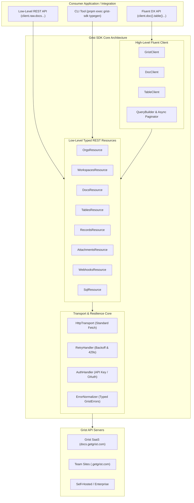
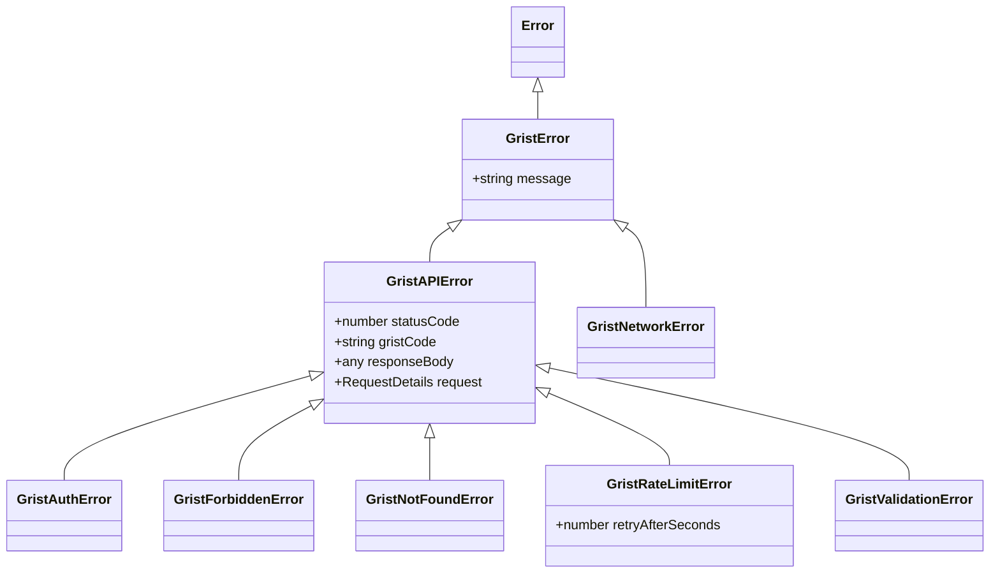

# Grist TypeScript SDK: Architecture & Design Specification

A modern, type-safe, developer-friendly Node.js and TypeScript SDK for the [Grist REST API](https://support.getgrist.com/api/).

---

## 1. Executive Summary & Goals

### 1.1 Objective
To create a production-grade, zero-dependency TypeScript SDK for Grist that bridges the gap between raw HTTP endpoints and an intuitive, strongly typed developer experience. It supports Grist SaaS (personal & team sites), self-hosted Grist instances, and enterprise deployments.

### 1.2 Core Pillars
1. **Layered Architecture**: Full coverage of the OpenAPI REST specification via typed low-level resource clients, topped with a high-level fluent API (`client.doc(...).table(...).records...`).
2. **Generics & Automated Typegen**: Built-in TypeScript generics for record schemas, complemented by an introspection CLI (`pnpm exec grist-sdk typegen`) that converts live Grist tables into `.d.ts` types.
3. **Standard Fetch & Edge-Ready**: Built on standard Web Fetch (compatible with Node 18+, Bun, Deno, Next.js, Cloudflare Workers, and browsers) with zero mandatory HTTP dependencies.
4. **Developer Experience (DX) First**: Clean `{ id, ...fields }` objects by default (with raw escape hatches), chainable query builders, batch upserting, and async iterators for auto-pagination.
5. **Built-in Resilience**: Configurable exponential backoff retry for HTTP 429 (rate limits) and 5xx server errors, coupled with a granular typed error hierarchy.
6. **Full-Spectrum Features**: First-class support for SQL queries, attachment uploading/downloading, schema modifications (tables/columns), and webhook lifecycle management.

---

## 2. System Architecture



---

## 3. Developer Experience (DX) & API Walkthrough

### 3.1 Client Initialization
The client supports explicit configuration, environment variables, or parsing a full Grist document URL directly:

```typescript
import { GristClient } from 'grist-api-sdk';

// 1. Auto-loaded from process.env.GRIST_API_KEY and process.env.GRIST_SERVER
const grist = new GristClient();

// 2. Explicit configuration (Personal or Team SaaS)
const grist = new GristClient({
  apiKey: 'YOUR_API_KEY',
  serverUrl: 'https://docs.getgrist.com', // or 'https://my-team.getgrist.com'
});

// 3. Self-hosted instance
const grist = new GristClient({
  serverUrl: 'http://localhost:8484',
  apiKey: 'YOUR_API_KEY',
});

// 4. Convenience factory: directly from a Grist document URL
const doc = GristClient.fromDocUrl('https://docs.getgrist.com/docId12345/Inventory', {
  apiKey: process.env.GRIST_API_KEY
});
```

---

### 3.2 Fluent Table & Record Operations

```typescript
interface Product {
  Title: string;
  Price: number;
  Stock: number;
  Category?: string;
  InStock?: boolean;
}

const doc = grist.doc('docId12345');
const products = doc.table<Product>('Products');

// 1. Fetch records (returns clean { id, Title, Price, ... }[])
const inStockProducts = await products.records.list({
  filter: { InStock: [true] },
  sort: ['-Price', 'Title'],
  limit: 50,
});

// 2. Single record lookup
const product = await products.records.get(142);
console.log(product.Title, product.Price);

// 3. Add record(s)
const newProduct = await products.records.create({
  Title: 'Wireless Mechanical Keyboard',
  Price: 99.99,
  Stock: 15,
  InStock: true,
});

// 4. Update record(s)
await products.records.update(142, {
  Price: 89.99,
  Stock: 10,
});

// 5. Batch Upsert / Sync (matches existing rows by specific key columns)
await products.records.upsert([
  { Title: 'Keyboard', Price: 79.99, Stock: 20 },
  { Title: 'Mouse', Price: 29.99, Stock: 50 },
], { keyCols: ['Title'] });

// 6. Delete record(s)
await products.records.delete([142, 143]);

// 7. Auto-Pagination Async Iterator (stream large tables efficiently)
for await (const row of products.records.iterate({ batchSize: 200 })) {
  console.log(`Processing row ${row.id}: ${row.Title}`);
}
```

---

### 3.3 Raw REST Escape Hatch
When needed, developers can access the exact Grist REST payload shape (`{ id, fields }`):

```typescript
// Fetch with exact REST response envelope
const rawRecords = await products.records.list({ raw: true });
// rawRecords -> [{ id: 142, fields: { Title: 'Keyboard', Price: 99.99 } }]
```

---

### 3.4 Direct SQL Querying
Grist supports querying documents via SQLite syntax over HTTP:

```typescript
interface SqlResult {
  Category: string;
  TotalRevenue: number;
  ItemCount: number;
}

const report = await doc.sql<SqlResult>(`
  SELECT Category, SUM(Price * Stock) as TotalRevenue, COUNT(*) as ItemCount
  FROM Products
  GROUP BY Category
  ORDER BY TotalRevenue DESC
`);
```

---

### 3.5 Attachments Handling

```typescript
// 1. Upload attachment
const fileBuffer = await readFile('./receipt.pdf');
const [attachmentId] = await doc.attachments.upload({
  filename: 'receipt.pdf',
  data: fileBuffer,
  contentType: 'application/pdf',
});

// 2. Link attachment to a record's Attachment column (e.g. ['L', attachmentId])
await doc.table('Expenses').records.create({
  Description: 'Office Supplies',
  Receipts: ['L', attachmentId],
});

// 3. Download attachment
const stream = await doc.attachments.download(attachmentId);
```

---

### 3.6 Schema & Webhook Management

```typescript
// Inspect & modify table structure
const tables = await doc.tables.list();
const columns = await doc.table('Products').columns.list();

await doc.table('Products').columns.create({
  id: 'DiscountCode',
  fields: {
    label: 'Discount Code',
    type: 'Text',
    isFormula: false,
  }
});

// Manage webhooks
const webhooks = await doc.webhooks.create({
  name: 'Sync to CRM',
  url: 'https://api.mycrm.com/grist-events',
  eventTypes: ['add', 'update'],
  tableId: 'Products',
});
```

---

## 4. Type Generation CLI (`grist-typegen`)

To achieve end-to-end type safety without manual interface maintenance, the SDK includes a dedicated CLI:

```bash
# Generate TypeScript definitions from a Grist document
pnpm exec grist-sdk typegen --doc <DOC_ID> --out src/types/grist.d.ts --api-key $GRIST_API_KEY
```

### Column Type Mapping Matrix

| Grist Column Type | Generated TypeScript Type | Notes |
| :--- | :--- | :--- |
| `Text` | `string` | UTF-8 text |
| `Numeric` / `Int` | `number` | Float / Integer |
| `Bool` | `boolean` | `true` or `false` |
| `Date` | `string` or `number` | Unix timestamp (seconds) or ISO string |
| `DateTime` | `number` | Timestamp in seconds |
| `Choice` | `string` (or union if options are enumerated) | Constrained options |
| `ChoiceList` | `['L', ...string[]]` or `string[]` | Encoded array |
| `Ref:TableId` | `number` | Record ID of target table |
| `RefList:TableId`| `['L', ...number[]]` | List of Record IDs |
| `Attachments` | `['L', ...number[]]` | List of Attachment IDs |

---

## 5. Error Handling & Resilience

### 5.1 Error Hierarchy


### 5.2 Retry Engine
- Automatically retries on `429 Too Many Requests` (honoring `Retry-After` header) and `5xx` server errors.
- Uses exponential backoff with jitter (`backoff = Math.min(maxDelay, baseDelay * 2 ** attempt + jitter)`).
- Configurable via `retryConfig`:
  ```typescript
  const grist = new GristClient({
    retry: {
      maxRetries: 3,
      baseDelayMs: 500,
      maxDelayMs: 10000,
    }
  });
  ```

---

## 6. Project Layout & Packaging Strategy

```
grist-api-sdk/
├── src/
│   ├── client/               # High-level client implementations
│   │   ├── GristClient.ts    # Main entry client
│   │   ├── DocClient.ts      # Document-scoped operations
│   │   ├── TableClient.ts    # Table-scoped operations
│   │   └── RecordManager.ts  # Record CRUD & pagination helpers
│   ├── resources/            # Low-level 1:1 REST resources
│   │   ├── OrgsResource.ts
│   │   ├── WorkspacesResource.ts
│   │   ├── DocsResource.ts
│   │   ├── TablesResource.ts
│   │   ├── RecordsResource.ts
│   │   ├── AttachmentsResource.ts
│   │   ├── WebhooksResource.ts
│   │   └── SqlResource.ts
│   ├── transport/            # HTTP transport & fetch wrappers
│   │   ├── HttpTransport.ts
│   │   ├── RetryHandler.ts
│   │   └── ErrorNormalizer.ts
│   ├── types/                # Core types & OpenAPI spec models
│   │   ├── openapi.ts        # Generated REST types
│   │   ├── records.ts        # Record shapes & query options
│   │   └── config.ts         # Client options & auth
│   ├── cli/                  # CLI generator tool
│   │   ├── index.ts          # CLI runner
│   │   └── typegen.ts        # Introspection to TS code emitter
│   ├── errors/               # Typed error classes
│   │   └── index.ts
│   └── index.ts              # Main SDK entry point
├── test/
│   ├── unit/                 # Unit tests (MockFetch, query building, transforms)
│   └── integration/          # Live/mock Grist server integration tests
├── bin/
│   └── grist-sdk.js          # Executable binary shim
├── tsup.config.ts            # Dual ESM/CJS build configuration
├── package.json
├── tsconfig.json
└── README.md
```

### Packaging & Builds
- **Target Formats**: Dual ESM (`dist/index.mjs`) and CommonJS (`dist/index.cjs`), with full declaration maps (`dist/index.d.ts`).
- **Engine Requirements**: Node.js >= 18.0.0 (or Bun / Deno / Edge).
- **Tooling**: Built with `tsup` for rapid tree-shaking and bundling, `vitest` for fast unit & mock tests, and standard `typescript`.

---

## 7. Implementation Roadmap

1. **Phase 1: Foundation (Transport & Types)**
   - Setup project tooling (`tsup`, `vitest`, `typescript`, `eslint`).
   - Implement `HttpTransport`, `AuthHandler`, `RetryHandler`, and custom error hierarchy.
   - Define core OpenAPI models and payload types.
2. **Phase 2: Low-Level REST Resources**
   - Implement resources for Orgs, Workspaces, Docs, Tables, Columns, Records, Attachments, Webhooks, and SQL.
   - Comprehensive unit testing with mocked HTTP responses.
3. **Phase 3: High-Level Fluent API**
   - Implement `GristClient`, `DocClient`, `TableClient`.
   - Implement record flattening/unflattening, query builder (`where`, `sort`, `limit`), and `iterate()` async iterator.
   - Implement `doc.sql()` and attachment helpers.
4. **Phase 4: CLI Typegen Tool**
   - Build `grist-sdk typegen` CLI command to introspect document schemas and emit `.d.ts` definitions.
5. **Phase 5: Documentation, Examples & Release**
   - Complete README with recipes (CRUD, upserts, SQL, typegen).
   - End-to-end integration verification and NPM package publication readiness.
